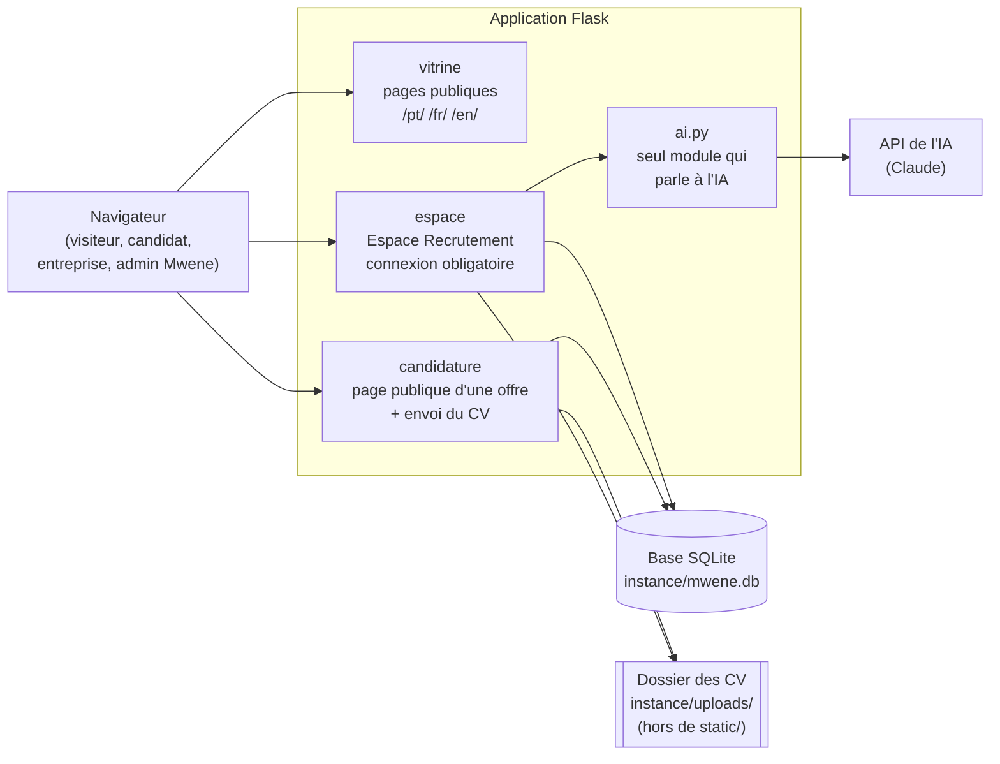
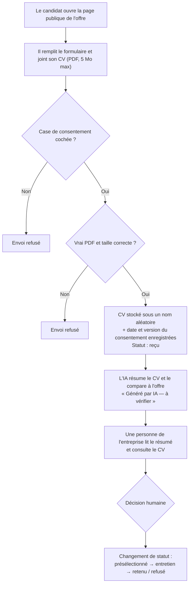

# Mwene Consulting, version 2 (Flask)

Mwene Consulting est un cabinet de conseil en ressources humaines pour les PME en Angola. Cette version 2 transforme son site statique en application web Flask. Elle comprend deux parties :

- **le site vitrine**, qui reprend à l'identique les pages de la v1 (accueil, services, à propos, contact, pages légales) ;
- **l'Espace Recrutement**, réservé aux entreprises clientes : offres d'emploi, candidatures avec consentement, suivi des candidats par statuts et aide de l'IA.

Tout le texte visible existe en **portugais (par défaut), français et anglais**. L'application est prévue pour **plusieurs pays**, chacun avec sa langue et sa devise. Au départ, seul l'Angola est enregistré.

> Ce projet est en cours de développement (voir [Avancement](#avancement)). Les schémas ci-dessous décrivent l'architecture **visée**, pas encore l'état actuel du code.

---

## Architecture



- Les trois parties (`vitrine`, `espace`, `candidature`) partagent les mêmes gabarits et les mêmes traductions (`translations/pt.json`, `fr.json`, `en.json`).
- Le dossier `instance/` contient la base et les CV. Il n'est **jamais** commité.
- Seul `app/ai.py` communique avec l'API de l'IA. La clé d'API se trouve dans `.env`, jamais dans le code.

## Parcours d'une candidature



L'IA ne fait que **proposer** un résumé. Elle ne change jamais un statut et ne classe pas les candidats. C'est toujours une personne qui décide.

---

## Technologies

| Rôle | Outil |
|---|---|
| Langage | Python 3 |
| Framework web | Flask 3.1 |
| Base de données | SQLite avec Flask-SQLAlchemy 3.1 |
| Tests | pytest |
| Gabarits HTML | Jinja (inclus dans Flask) |
| Styles | le `style.css` de la v1, repris tel quel |

Prévus dans les prochaines étapes (voir le plan) : Flask-Login (connexion), Flask-WTF (protection CSRF), Flask-Limiter (limite des tentatives de connexion), python-dotenv (lecture du fichier `.env`), pypdf (lecture du texte des CV) et le SDK `anthropic` (API de l'IA).

## Structure des dossiers

État actuel (après l'étape 1) :

```
app/
  __init__.py        ← create_app() : la « fabrique » qui construit l'application
  config.py          ← réglages (développement, test)
tests/
  conftest.py        ← fixtures pytest « app » et « client »
  test_app.py
docs/
  PLAN-v2.md         ← plan détaillé de la v2, en 14 étapes
  GUIDE-v1.md        ← guide de la v1 (site statique)
requirements.txt     ← dépendances Python
pytest.ini
.env.example         ← modèle du fichier .env (variables secrètes)
*.html, css/, js/    ← fichiers de la v1, supprimés à l'étape 5
```

Structure visée à la fin du plan :

```
app/
  __init__.py, config.py
  i18n.py              ← t(clé, langue)
  models.py            ← Country, Company, User, JobOffer, Candidate
  vitrine/routes.py    ← pages publiques
  espace/routes.py     ← Espace Recrutement
  candidature/routes.py ← page publique d'une offre + envoi de CV
  ai.py                ← appels à l'IA
  templates/           ← base.html, partials/, pages…
  static/              ← css/style.css, js/main.js
translations/          ← pt.json, fr.json, en.json
tests/
instance/              ← base SQLite + CV (jamais commités)
```

## Commandes

Toutes les commandes se lancent depuis la racine du projet.

**Installer** (la première fois) :

```bash
python3 -m venv .venv
source .venv/bin/activate
pip install -r requirements.txt
```

Ensuite, à chaque nouvelle session, il suffit d'activer l'environnement :

```bash
source .venv/bin/activate
```

**Lancer le site en développement** :

```bash
flask --app app run --debug --port 5001
```

Ouvrez ensuite http://127.0.0.1:5001/. Sur Mac, il faut utiliser le port 5001, car le port 5000 (celui de Flask par défaut) est pris par AirPlay.

**Lancer les tests** :

```bash
pytest                      # tous les tests
pytest tests/test_app.py    # un seul fichier
```

---

## Principes de sécurité

- **Les CV sont des données personnelles.** Aucune candidature n'est acceptée sans le consentement du candidat. La date et la version du texte accepté sont enregistrées. Les CV sont contrôlés (vrai PDF, 5 Mo maximum), puis stockés sous un nom aléatoire dans `instance/uploads/`, **jamais dans `static/`**. Ils ne sont donc pas accessibles par une simple adresse. Supprimer un candidat supprime aussi son fichier (droit à l'effacement).
- **Isolation entre entreprises.** Chaque entreprise ne voit que ses propres offres, candidats et CV. Toutes les requêtes filtrent par l'entreprise de l'utilisateur connecté, grâce à une seule fonction réutilisée partout. Des tests vérifient qu'une entreprise B reçoit une erreur 404 sur les données d'une entreprise A.
- **L'IA ne décide jamais.** Elle propose des brouillons d'offres et des résumés de CV, toujours relus par un humain. Elle n'a accès à aucune action : elle ne publie rien, ne change aucun statut et ne classe personne. Le texte d'un CV est traité comme une donnée, jamais comme une instruction (protection contre la *prompt injection*).
- **Comptes et connexion.** Il n'y a pas d'inscription publique : les comptes sont créés par un administrateur Mwene. Les mots de passe sont hachés, les formulaires sont protégés contre le CSRF, et le nombre de tentatives de connexion est limité.
- **Secrets.** La clé `SECRET_KEY` et la clé de l'API de l'IA se trouvent dans `.env`, qui n'est jamais commité. `.env.example` montre les variables attendues, sans leurs valeurs.

## Avancement

**Étape 1 sur 14 terminée** : squelette Flask avec pytest.

Le détail des 14 étapes, avec ce que chacune construit et comment la vérifier, se trouve dans [docs/PLAN-v2.md](docs/PLAN-v2.md).

## Version 1

La v1 (site statique HTML/CSS/JS, toujours disponible sur la branche `main`) est documentée dans [docs/GUIDE-v1.md](docs/GUIDE-v1.md). Ce guide contient notamment la liste des tâches avant mise en ligne.
